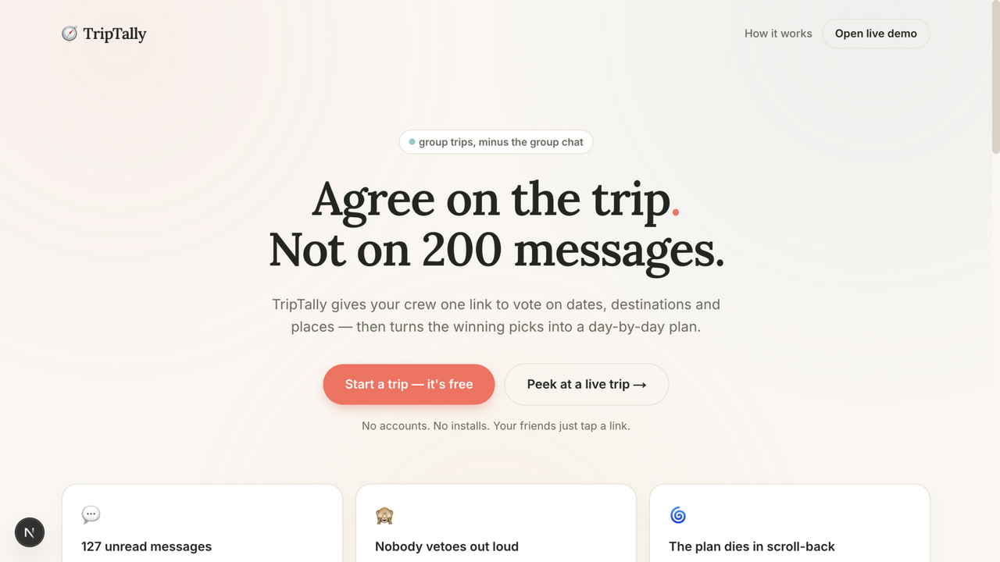
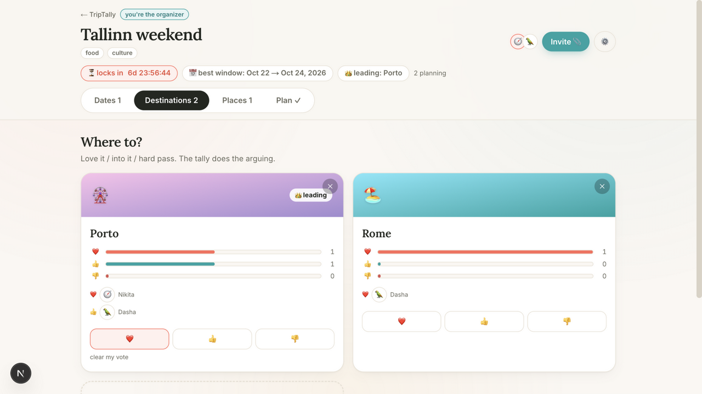
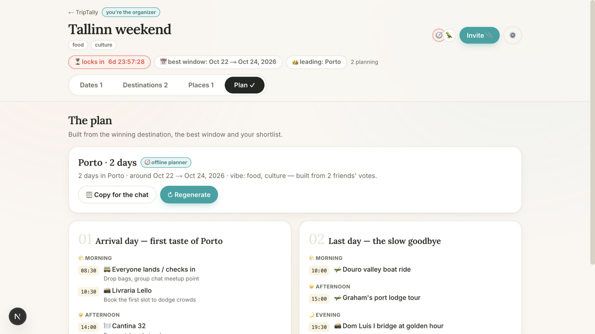

# 🧭 TripTally

**Plan trips together — not over group chat.**

TripTally is a collaborative trip planner for friend groups. One person starts a trip, drops a link in the chat, and everyone votes on **dates**, **destinations** and **places** — no accounts, no installs. When the votes settle, TripTally turns them into a day-by-day itinerary.

| Landing | Voting | The plan |
| --- | --- | --- |
|  |  |  |

## The problem it solves

Group trips die in the group chat: dates scattered across threads, that one restaurant idea lost in scroll-back, and nobody willing to be the friend who vetoes out loud. TripTally gives the whole decision one home:

- **📅 Date voting** — a When2meet-style availability grid with a live overlap heatmap and "best window for everyone" highlight.
- **🗳️ Destination voting** — ❤️ love it / 👍 into it / 👎 hard pass, with live tallies and a decision deadline that locks the winner (confetti included).
- **📍 Places shortlist** — anyone can throw in places; upvotes rank the leaderboard.
- **🕵️ Anonymous mode** — organizers can hide *who* voted for *what*, so quiet friends can be honest without social friction.
- **🗺️ Plan generation** — a day-by-day itinerary built from the winning destination, the best window, and the group's shortlisted places.

## Run it

```bash
npm install
npm run dev
# open http://localhost:3000
```

That's it — no migrations, no external services. On first boot the app creates a SQLite database at `data/triptally.db` (schema bootstraps itself) and seeds a demo trip, **"Squad city break 🇵🇹"**, with five friends mid-vote. Open it from the landing page ("Peek at a live trip") or join with invite code `DEMO24`.

```bash
npm test        # unit tests (vote tallies, decision logic, planner)
npm run build   # production build
npm run db:push # optional: sync Drizzle schema after editing it
```

### Enabling AI-generated plans

Out of the box the plan is generated by a **deterministic offline planner** (curated destination data + your group's shortlist) — the demo works with zero keys. To use a real LLM instead, drop an [OpenAI-compatible](https://platform.openai.com/docs/api-reference/chat) API into `.env.local` (see `.env.example`):

```ini
LLM_API_KEY=sk-...
LLM_BASE_URL=https://api.openai.com/v1   # or any compatible endpoint
LLM_MODEL=gpt-4o-mini
```

The LLM response is validated against a Zod schema; on any failure (no key, timeout, malformed JSON) the app silently falls back to the offline planner — the generate button never breaks.

## Architecture

```mermaid
flowchart LR
  subgraph Client["Browser (React 19, client components)"]
    UI[Trip room UI<br/>tabs · optimistic votes]
    SSE[EventSource]
  end

  subgraph Server["Next.js 16 (App Router, Node runtime)"]
    PAGES[Server pages<br/>/ · /join/[code] · /trip/[id]]
    API[Route handlers /api/trips/...<br/>create · join · vote · items · plan]
    STATE[buildTripState<br/>one read pass → full state]
    DECIDE[decision.ts<br/>tallies · winner · deadline]
    PLAN[planner.ts fallback<br/>+ llm.ts]
    BUS[Event bus (SSE)]
  end

  DB[(SQLite<br/>better-sqlite3 + Drizzle)]

  UI -->|fetch| API --> DB
  PAGES --> STATE --> DB
  API --> BUS -->|trip changed| SSE -->|refetch| UI
  PLAN --> DB
```

- **Stack**: Next.js 16 (App Router, TypeScript, Turbopack) · Tailwind CSS v4 · SQLite via better-sqlite3 + Drizzle ORM · Framer Motion · Zod · Vitest.
- **Realtime**: every mutation publishes to an in-process event bus; connected clients receive an SSE ping and refetch the trip state. Votes are applied optimistically in the UI and reconciled by the refetch. (Single-process by design — fine for a demo; swap the bus for Redis pub/sub to scale out.)
- **Identity without accounts**: each trip recognizes you via an HTTP-only cookie holding your participant id. Joining is just "name + emoji avatar". The organizer gets a secret admin link that grants edit powers on any device.
- **Decision logic is pure** (`src/lib/decision.ts`): tallies, winner tie-breaks (score → loves → fewest vetoes → name), overlap scoring, deadline locking — all unit-tested, all reusable.
- **Graceful AI**: the LLM call and the offline planner produce the same `Itinerary` shape; the UI badges which one generated the current plan.

### Project layout

```
src/
  app/                     # pages + route handlers
    api/trips/[id]/…       # join · vote · places · destinations · date-options · plan · events (SSE) · admin
    join/[code]/           # invite link → pick name + avatar
    trip/[id]/             # the trip room (server shell → client TripRoom)
  components/
    CreateTripForm.tsx     # landing-page form
    JoinForm.tsx
    room/                  # TripRoom shell + Dates / Destinations / Places / Plan tabs
  lib/
    db/                    # Drizzle schema, self-bootstrapping connection, demo seed
    decision.ts            # pure tally/winner/deadline logic
    planner.ts             # deterministic offline planner
    planner-data.ts        # curated destination dataset
    llm.ts                 # OpenAI-compatible client (structured output, timeouts)
    events.ts              # SSE event bus
    state.ts               # assembles the full client state
tests/                     # Vitest unit tests
```

## Why it's built this way

- **Zero-setup by default.** A reviewer cloning this repo runs `npm install && npm run dev` and gets a working multiplayer app with demo data. SQLite bootstraps its own schema; drizzle-kit exists for real migrations when the schema evolves.
- **The group is the product, so onboarding is one link.** Every design decision bends toward "will the *friends* actually participate": no accounts, phone-first layout, one-tap voting, anonymous mode for social friction, and a deadline so decisions actually conclude.
- **AI as a feature, not a dependency.** LLM itinerary generators are commodity; TripTally's core value is the decision layer. The offline planner guarantees the core demo always works, and the AI badge in the UI makes the two modes honest.

---

Built as a portfolio project. Demo data is fictional; no real travel APIs are called.
